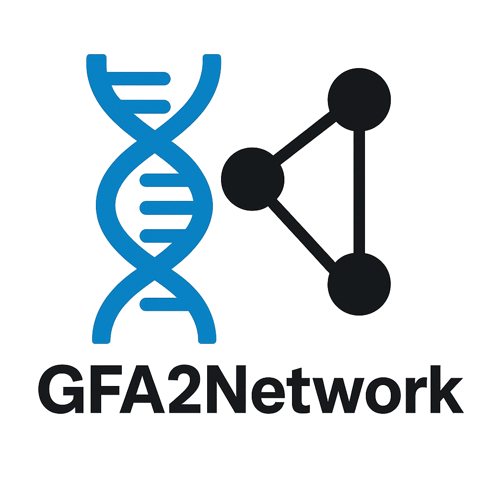

<p>
  
</p>

# GFA2Network: Streaming GFA→Graph Converter

**GFA2Network** is a small Python library that converts
[GFA-1](https://github.com/GFA-spec/GFA-spec) and
[GFA-2](https://github.com/GFA-spec/GFA-spec/blob/master/GFA2.md) files into
convenient in-memory representations.  GFA (Graphical Fragment Assembly) is a
common exchange format for pangenome graphs.  This package reads those graphs in
a streaming fashion and exposes them either as a `networkx` graph object or as a
SciPy sparse adjacency matrix. The resulting graph or matrix remains in memory;
the parser does not load the complete input text at once.

The command **gfa2network** can build:

- a `networkx.Graph` / `DiGraph`, and/or
- a SciPy sparse adjacency matrix.

Ordinary conversion reads the input once and uses memory proportional to stored
nodes, edges, and optional metadata: O(V + E), plus sequence and tag payloads.
Alignment splitting retains additional records. Distance analysis reads the file
more than once and has additional memory costs described below. Large-graph
capacity depends on the backend, topology, metadata, and available memory.

## Features

- Handles GFA‑1 and GFA‑2 link syntax
- Build directed or undirected graphs
- Streaming input with O(V + E) graph storage, plus optional metadata
- Optional edge weights from a tag (e.g. `RC`)
- Optional sequence storage on nodes
- Adjacency matrices in several sparse formats
- Helper utilities to convert or save matrices
- Bidirected graph representation via `--bidirected`
- Alignment-aware splitting via `--split-on-alignment`
  (may increase memory usage; a warning is shown if >10× nodes are created)
- Compute graph distances between stored sequences or path node sets
- `distance` subcommand to query sequences or paths
- `distance-matrix` subcommand to compute pairwise path distances
- Export edges to various formats with the `export` subcommand
- Transparent support for gzip-compressed input files (`*.gfa.gz`)

The adjacency matrix can be written in several SciPy sparse representations:

* **CSR (Compressed Sparse Row)** – efficient row slicing, used by default.
* **CSC (Compressed Sparse Column)** – efficient column slicing.
* **COO (Coordinate)** – straightforward triplet format, convenient for
  incremental construction.
* **DOK (Dictionary of Keys)** – a hash map representation useful for updates.

These formats are explained in more detail in the
[SciPy documentation](https://docs.scipy.org/doc/scipy/reference/sparse.html).

The repository ships with a real world test graph,
[`DRB1-3123_unsorted.gfa`](tests/data/DRB1-3123_unsorted.gfa), containing about
9500 lines from the human *DRB1* region.  Use it to experiment with the CLI
or run the unit tests:

```bash
gfa2network convert tests/data/DRB1-3123_unsorted.gfa \
    --graph --matrix drb1.npz --verbose
```

Run the small test suite with:

```bash
python -m pytest
```

## Installation

Install the package directly from GitHub using `pip`:

```bash
pip install git+https://github.com/sclipman/gfa2network.git
```


## Dependencies

Install the requirements with:

```bash
pip install -r requirements.txt
```

For optional progress bars, you can install the extra dependency with:

```bash
pip install -e ".[tqdm]"
```

This project targets Python 3.8 or later and depends on the following packages:
- `networkx`, `numpy` and `scipy` for graph handling and sparse matrices
- `tqdm` (optional) for progress bars on long‑running operations
- `pytest` (optional) for running the unit tests
- `python-igraph` (optional) for the igraph backend

## Comparison to Other Tools

[`gfapy`](https://github.com/ggonnella/gfapy) focuses on full read/write support for every GFA field, building in-memory object models for complete round-trip fidelity.  
[`vg`](https://github.com/vgteam/vg) and [`ODGI`](https://github.com/pangenome/odgi) are C++-based pangenome graph engines offering highly optimized data structures, indexing, mapping, variant calling and a suite of built-in algorithms.

**GFA2Network** occupies a different niche: it’s a **lightweight, streaming parser** that converts GFA files **line-by-line** into familiar Python graph representations with **minimal RAM usage**. Use GFA2Network when you:

- Only need **basic connectivity** (nodes and edges) rather than full GFA compliance  
- Want to apply **custom NetworkX algorithms** (centrality, clustering, shortest paths) without learning a new C++ API  
- Prefer a **sparse-matrix view** (SciPy) for downstream analyses (PCA, distance-based clustering)  
- Want to convert supported records without retaining the complete input text

### Key Benefits of GFA2Network

- **Streaming & low memory overhead**  
  Reads records incrementally; memory includes nodes, edges, and stored metadata.
- **Native Python graph objects**  
  Outputs `networkx.Graph` or SciPy sparse matrix out of the box; optional igraph backend for C-level performance.  
- **Flexible metadata support**  
  Attach sequences or tag dictionaries as node/edge attributes for richer analyses in pandas, scikit-learn, etc.  
- **Minimal, common dependencies**  
  Installable from GitHub; extra features (e.g. `python-igraph`, `tqdm`) are optional.
- **Seamless integration**  
  Combine with any Python data-science stack—no heavyweight toolkit required.  

## Quick Start

The examples below illustrate typical use cases.  Replace `input.gfa` with your
own data set.  Files may also be gzip-compressed (`input.gfa.gz`).

```bash
# Build both representations (directed NetworkX graph and CSR matrix)
gfa2network convert input.gfa --graph --matrix adj.npz

# Matrix only (uses the least amount of memory) in the COO format
gfa2network convert input.gfa --matrix adj.npz --matrix-format coo

# Directed graph only with verbose progress output
gfa2network convert input.gfa --graph --verbose

# Split segments on alignment boundaries
gfa2network convert input.gfa --graph --split-on-alignment

# Build an igraph representation and save it to disk
gfa2network convert input.gfa --graph --backend igraph -o graph.pkl

# Stream from standard input and strip orientation symbols (legacy behaviour)
cat input.gfa | gfa2network convert - --graph --strip-orientation

# Compute basic graph statistics
gfa2network stats input.gfa

# Export a simple edge list
gfa2network export input.gfa --format edge-list > edges.txt

# Shortest path between two sequences
gfa2network distance input.gfa --seq ACGT TTTT

# Distance between two paths
gfa2network distance input.gfa --path sample1 sample2

# Pairwise distances between all paths
gfa2network distance-matrix input.gfa -o distances.csv

```


See `gfa2network -h` for all command line options.

| Option             | Purpose |
| ------------------ | ------- |
| `convert`          | Convert a GFA into graph and/or matrix |
| `stats` (`stat`)   | Print basic statistics |
| `export`           | Stream edges in various formats |
| `distance`         | Compute distances between sequences or paths |
| `distance-matrix`  | Compute pairwise path distances |
| `--graph`          | Build a NetworkX object |
| `--matrix PATH`    | Write adjacency matrix to PATH |
| `--matrix-format`  | Sparse format for `.npz`. One of `csr`, `csc`, `coo` or `dok` |
| `--no-node-map`    | Do not write `<matrix>.nodes.tsv` |
| `-o PATH, --output PATH` | Save graph pickle to PATH |
| `--backend`        | Backend for graph building (`networkx`\|`igraph`, commands: `convert`, `distance`, `distance-matrix`) |
| `--directed`       | Treat graph as directed (default) |
| `--undirected`     | Treat graph as undirected |
| `--weight-tag TAG` | Use numeric value of GFA tag `TAG` as edge weight |
| `--store-seq`      | Keep sequences from `S` records on nodes |
| `--store-tags`     | Attach tag dictionaries and lengths |
| `--strip-orientation` | Remove `+/-` from IDs (legacy) |
| `--bidirected`     | Use bidirected node representation |
| `--raw-bytes-id`   | Use legacy byte strings for node IDs |
| `--keep-directed-bidir` | Keep directed bidirected edges |
| `--verbose`        | Emit progress information while parsing |
| `--max-dense-gb N` | Abort dense matrix saves over N GB |
| `--max-tag-mb N`   | Warn when stored tags exceed N MB |
| `--version`        | Print package version |

Shared options `--raw-bytes-id`, `--max-dense-gb`, and `--max-tag-mb` can be
placed before or after the subcommand. The igraph backend rejects
`--split-on-alignment` and `--raw-bytes-id`, which it does not implement.

`--store-seq` may drastically increase memory usage. For NetworkX conversion,
`--verbose` can report stored sequence payloads exceeding half of the available
RAM on Linux. This estimates payload size, rather than total process memory.
The flag is ignored when only `--matrix` is requested. The `--store-tags` option
adds tag dictionaries and segment lengths to the graph. The NetworkX backend
emits a `RuntimeWarning` when estimated stored tags exceed `--max-tag-mb`
(default 100&nbsp;MB); this threshold is not implemented by the igraph backend.

## Using in Python

Import the convenience function `parse_gfa` in your own Python scripts in order
to generate graphs programmatically:

```python
from gfa2network import parse_gfa

# Build a NetworkX graph
G = parse_gfa("input.gfa", build_graph=True, build_matrix=False)
# Compressed input works as well
Gz = parse_gfa("input.gfa.gz", build_graph=True, build_matrix=False)
# Store sequences on nodes
G_seq = parse_gfa("input.gfa", build_graph=True, build_matrix=False, store_seq=True)
# Store tags and segment lengths
G_tags = parse_gfa("input.gfa", build_graph=True, build_matrix=False, store_tags=True)
```

Additional helpers are provided in ``gfa2network.analysis``:

```python
from gfa2network.analysis import (
    sequence_distance, genome_distance, genome_distance_matrix, load_paths,
)

# Distance between two sequences stored on nodes
dist = sequence_distance(G_seq, "ACGT", "TTTT")

# Load path definitions and compare two genomes
paths = load_paths("input.gfa")
dist2 = genome_distance(G, paths["p1"], paths["p2"])

# Pairwise distances between all paths
mat = genome_distance_matrix("input.gfa")
```

`sequence_distance` locates nodes by their stored sequence strings and returns
the shortest path length between them.  `genome_distance` accepts two node
sets and calculates either the minimal or mean distance (``method="min"`` or
``"mean"``).  The helper ``load_paths`` reads ``P`` or ``O`` records from a GFA
file and maps path names to node lists for convenient lookup. ``genome_distance_matrix``
computes all pairwise distances between paths and returns a matrix or dataframe.
Distance helpers currently require NetworkX. igraph is supported for conversion.

### Distance matrix

``genome_distance_matrix`` builds an undirected graph and reuses one multi-source
Dijkstra search per path. With P paths and V nodes, the distance cache can occupy
O(PV) memory, in addition to the O(P²) output and graph storage. Pair aggregation
also depends on path lengths; total runtime is not linear in P.

The two existing ``mean`` methods have different definitions:

- ``genome_distance(..., method="mean")`` averages all reachable node pairs.
- ``genome_distance_matrix(..., method="mean")`` averages distances from each
  node to the nearest node of the other path, in both directions.

Both exclude unreachable contributions, which can hide disconnected portions
of paths. These are graph topology summaries; a minimum distance of zero means
the paths share a node and does not establish sequence identity. Path order,
alignment, and nucleotide substitution are not represented by this calculation.
Repeated nodes can contribute multiple times to means. ``min`` and ``mean`` are not validated genomic divergence
measures. Matrix diagonals are set to zero by convention.

``genome_distance`` with ``method="mean"`` performs ``|A| × |B|`` shortest path
computations. A warning is emitted when more than 1000 node pairs are examined:

```python
>>> genome_distance(G, nodes_a, nodes_b, method="mean")
RuntimeWarning: Mean distance scales quadratically; this may be very slow on large sets
```
Set ``GFANET_DISABLE_WARNINGS=1`` to silence this message.

Pass `store_seq=True` to attach the sequences from `S` records as the
`sequence` attribute on each node.  You can also set `directed=False` for an
undirected graph or specify a `weight_tag` to use numeric edge weights.  The
module additionally exposes a helper `convert_format` to turn the returned COO
matrix into CSR/CSC/DOK formats.

### ``parse_gfa`` parameters

| Argument | Meaning |
| -------- | ------- |
| ``path`` | Input GFA file or ``-`` for stdin |
| ``build_graph`` | Return a NetworkX graph |
| ``build_matrix`` | Return an adjacency matrix |
| ``directed`` | Treat graph as directed (default ``True``) |
| ``weight_tag`` | Numeric GFA tag to use as edge weight |
| ``store_seq`` | Attach sequences to nodes |
| ``store_tags`` | Attach tag dictionaries and lengths |
| ``strip_orientation`` | Remove ``+/-`` from segment IDs |
| ``verbose`` | Print progress messages |
| ``bidirected`` | Append orientation to node IDs |
| ``raw_bytes_id`` | Use byte strings for node IDs |

## Graph Interpretation

The resulting graphs drop any absolute coordinates from the GFA file and
encode only connectivity.  When ``--bidirected`` is used, segment
identifiers are expanded to ``<id>:+`` and ``<id>:-`` so that each node
represents a specific orientation. Distance matrices use undirected topology
and ignore coordinates. The graph-based helpers respect the direction of the
supplied graph. If you build a directed
graph (for example with ``--keep-directed-bidir``), convert it to an
undirected one via ``G = G.to_undirected()`` before calling the
distance helpers.

## Implementation Notes

The parser recognises segment (`S`), link (`L`), edge (`E`), containment (`C`)
and path/walk (`P`/`O`) records of the GFA specification. Orientation symbols
`+` and `-` are retained by default so that the directionality of edges and paths
is preserved.  The option `--strip-orientation` reproduces the historic
behaviour of discarding these signs.  All additional GFA tags are collected into
a dictionary, enabling the use of numeric tags as edge weights via the
`--weight-tag` option.

GFA2 `E` records use two oriented references followed by four coordinates;
terminal `$` coordinate markers are accepted. The historical nonstandard edge
layouts remain accepted for compatibility. GFA2 `O` records use **space-separated**
references; convert older comma-separated `O` records to the standard layout.
GFA1 `P` records continue to use commas. GFA1.1 `W` walks and gap/jump records
are currently unsupported and should not be relied on for path analysis.

Alignment splitting remains experimental. It can discard sequence/tag metadata,
misplace links when a segment has multiple subintervals, and create extra
unoriented vertices when combined with `--bidirected`. Avoid using these
combinations for downstream analysis until the splitting implementation is
reworked and independently checked.

Repeated links are currently handled differently by simple NetworkX graphs and
sparse matrices: a graph retains one edge while COO entries are summed when
converted to CSR. Choose inputs without repeated links when comparing these
representations until a shared aggregation policy is implemented.

## Output

When invoked as a script, the resulting NetworkX graph is available as the
variable `G`.  The `-o`/`--output` option stores this graph on disk (either as a
NetworkX pickle or as an igraph pickle, depending on the backend).  If
`--matrix` is specified, the adjacency matrix is saved to the given file
(`.npz`, `.npy` or `.csv`).  Matrices are initially produced in the COO format
and may subsequently be converted to another sparse representation using the
`convert_format` helper function.
When a matrix is written, a sidecar file `<matrix>.nodes.tsv` lists the
corresponding node identifier for each row/column index.  Use `--no-node-map`
to suppress this file.

## License

This project is licensed under the MIT License. See [LICENSE](LICENSE) for
details.

## Disclaimer
This software is supplied 'as-is', with no warranty of any kind expressed or implied. The author has made a reasonable effort to avoid errors in design and execution of this software, but will not be liable for its use or misuse. The user is solely responsible for the validity of any results generated. Specifically, the author is not liable for any damage or data loss resulting from the use of this software, even if it is due to negligence on the part of the author of this software. This software and this document are the responsibility of the author. The views expressed herein do not necessarily represent the views of Johns Hopkins University.
